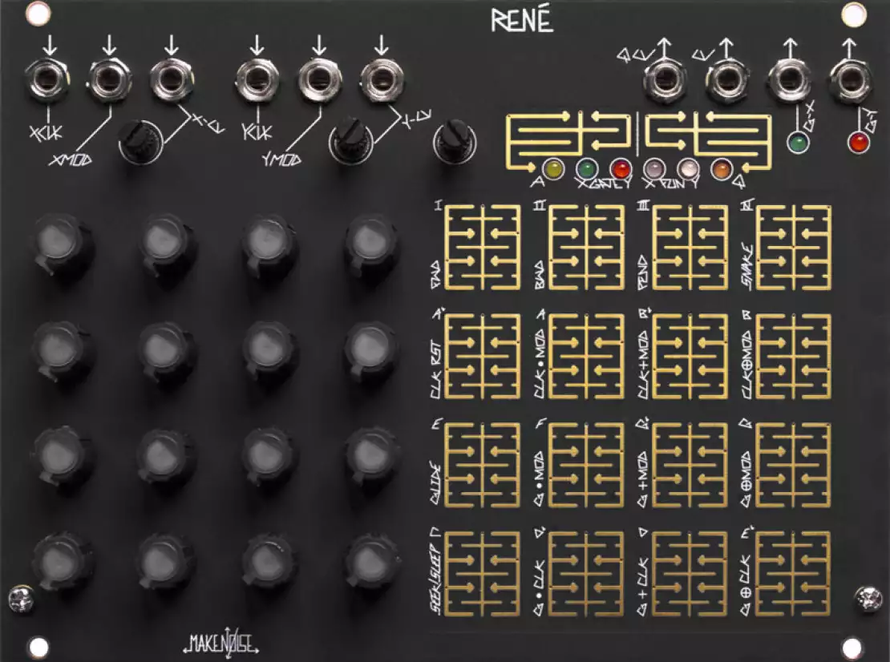

# Make Noise René (v1)

{width=600}

**Manufacturer:** Make Noise  
**Type:** Cartesian Sequencer  
**HP:** 34 | **Depth:** 24mm  
**Power:** +12V 80mA / -12V 0mA

[Download Manual](../manuals/rene.pdf)

---

## Overview

René is a Cartesian sequencer: instead of stepping linearly through its 16 knobs, it maps X and Y coordinates (each 0–3) onto a 4x4 grid of "locations". Each axis has its own clock, CV, and MOD input, so two clocks running at different rates produce long, non-repeating paths through only 16 programmed voltages. There are no menus — all editing happens in real time on the touch grid and six ProGraM pages (Access, X-Gate, Y-Gate, X-Fun, Y-Fun, Q), which makes programming part of the performance.

!!! warning
    René v1 does not work on power solutions using MeanWell brand AC adapters.

---

## Inputs & Outputs

| Jack | Signal | Notes |
|------|--------|-------|
| X-CLK | Clock/Gate (>2.5V, >0.5ms) | Drives the X-axis counter. In Snake mode, steps through the stored path |
| X-MOD | Gate (HI/LO) | Behaviour set on X-Fun page: reset, glide, or logic (AND/OR/XOR) against X-CLK |
| X-CV | CV (with attenuator) | Added to the X counter value. Normalled to +5V, so the attenuator acts as an offset |
| Y-CLK | Clock/Gate (>2.5V, >0.5ms) | Drives the Y-axis counter. In Snake mode, selects one of 8 stored paths |
| Y-MOD | Gate (HI/LO) | Behaviour set on Y-Fun page: reset, glide, or logic against Y-CLK |
| Y-CV | CV (with attenuator) | Added to the Y counter value. Normalled to +5V. In Snake mode, selects the stored path |
| QCV OUT | CV, 4 octaves | Quantized voltage of the active location (or a Stored Quantized Voltage set) |
| CV OUT | CV, 0–4.5V | Unquantized voltage of the active location. Knobs are always live here |
| GATE X OUT | Gate, 0/+8V | Fires on locations enabled on the X-Gate page. 2ms trigger in Snake mode |
| GATE Y OUT | Gate, 0/+8V | Fires on locations enabled on the Y-Gate page. 2ms trigger in Snake mode |

---

## Controls

| Control | Function |
|---------|----------|
| 4x4 knob grid | Sets the voltage for each of the 16 locations; LEDs show the active location |
| 4x4 touch grid | In Play: touch to restrict movement to held locations or set a new start point. In PGM pages: toggles parameters |
| PGM 1 | Cycles through the six ProGraM pages |
| PGM 2 | In Play: latches the currently held locations. In PGM pages: returns to Play. Hold 2s to save the current state as the start-up state |
| SENS | Touch grid sensitivity (fully CW = most sensitive) |
| X-CV / Y-CV attenuators | Scale incoming CV, or act as manual offsets when nothing is patched |

---

## ProGraM Pages

| Page | Purpose |
|------|---------|
| ACCESS | Enables/disables locations. Denied locations are skipped (Seek) or waited out (Sleep) |
| X-GATE | Which locations fire a gate at GATE X |
| Y-GATE | Which locations fire a gate at GATE Y |
| X-FUN / Y-FUN | Per-axis counting (FWD / BWD / PEND), Snake mode, CLK RST, Glide, Seek/Sleep, and logic operations |
| Q | Scale for QCV (locations 0–11 = C through B), plus four Stored Quantized Voltage slots (locations 12–15) |

**Cartesian (default):** Each axis counts 0–3 independently. The X and Y counts together form the coordinate of the next location, so changing the relative clock rates reshapes the pattern.

**Snake:** X-CLK and X-CV scan linearly through one of 8 memorised paths; Y-CLK and Y-CV choose which path. Movement is more predictable, and the gate outputs give a 2ms trigger per move along the corresponding axis — good for pinging low pass gates.

**Logic operations (X-Fun / Y-Fun):** three rows combine the axis' MOD input with its clock using AND, OR, or XOR.

- Locations 9–11 (CLK by MOD) affect movement and gates.
- Locations 5–7 (Gate by MOD) affect only the gate output.
- Locations 1–3 (Gate by Opposing CLK) combine the gate with the other axis' clock.

Gate width of the incoming clock and MOD signals has a big effect on the results.

---

## Patching Notes

**Simplest patch:** Patch one clock to X-CLK and a second, different-rate clock to Y-CLK. Send QCV to a VCO's 1V/oct and either gate output to an envelope or VCA. Shifting one clock relative to the other produces endless variations on the same 16 notes.

!!! tip
    With no clocks patched, touching a location holds its voltage at the outputs — handy for tuning each knob against a VCO.

**Two CV channels from one sequence:** On the Q page, store the current knobs and scale to one of the SQV slots (hold location 12–15 until the PGM LEDs flash). QCV now plays the stored notes, freeing the knobs and CV OUT to program a separate timbre sequence (filter cutoff, wavefolding, FM index).

**Rests and pauses:** Deny Access to a few locations and switch the axis to Sleep — René keeps counting until it lands on an allowed location, creating rests instead of skipping ahead.

**Self-modulating patch:** Patch CV OUT (optionally through an attenuator) back into X-CV. Locations with high voltages make the sequence jump, while groups of low-value knobs create "eddies" where it lingers.

!!! note
    If using Maths to clock René, set its Vari-Response to LINEAR.
